# FedAvg vs FedProx on PathMNIST with one noisy client

Federated learning on PathMNIST (MedMNIST, 9 tissue classes, 28×28 RGB) with 5 clients, a non-IID Dirichlet
split (α = 0.3) and 40 % symmetric label noise on one client, built on
[PFLlib](https://github.com/TsingZ0/PFLlib). This repository is a fork of PFLlib at commit
`0169ba7e412c9856a08bb3faefab1e35f538a3c1`; every change on top of that commit is listed in
[Changes to PFLlib](#changes-to-pfllib). The original PFLlib README is kept as [README_PFLlib.md](README_PFLlib.md).

- **W&B project (public, all runs, every round):** https://forge.coreweave.com/wandb/sonishifa7-jk-lakshmipat-university/fl-pathmnist-noisy
- All logged metrics are also committed in `outputs/*/metrics.jsonl`, so the results do not depend on W&B access.
- **Pre-registered protocol and amendments:** [PROTOCOL.md](PROTOCOL.md)
- **All figures and tables:** [plots/](plots/) (generated by `system/plot_results.py`)

**Headline (final-round global test accuracy, 200 rounds, mean ± sd over 3 seeds, noisy setting):**
FedAvg 64.9 ± 1.6, FedProx μ = 0.01 64.9 ± 0.8, FedProx μ = 0.1 (validation-selected) 66.5 ± 0.8.
FedProx with the assignment's μ = 0.01 is indistinguishable from FedAvg; μ = 0.1 gives a small, consistent
advantage (+0.7 to +2.1 points on every seed) and fits the noisy client's wrong labels far less (Fig. 8).

---

## Contents

1. [Task and setup](#task-and-setup)
2. [Requirement → code map](#requirement--code-map)
3. [Changes to PFLlib](#changes-to-pfllib)
4. [Reproduce](#reproduce)
5. [What is logged](#what-is-logged)
6. [Results](#results)
7. [Extension: noise penalty with paired clean baselines](#extension-noise-penalty-with-paired-clean-baselines)
8. [Disclosures and limitations](#disclosures-and-limitations)
9. [Repository layout](#repository-layout)

---

## Task and setup

| Item | Value |
|---|---|
| Data | PathMNIST 28×28 via `medmnist` 3.0.2; official splits train 89,996 / val 10,004 / test 7,180 |
| Clients | 5, all participate every round (`-jr 1`) |
| Partition | Dirichlet α = 0.3 over the official **train** split, using PFLlib's `separate_data`; fixed `split_seed = 0` (the partition is the same in every run) |
| Per-client test data | the official test split, allocated per class in proportion to each client's share of that class in train (largest-remainder rounding) |
| Validation | the official val split, kept by the server, **never trained on; used only for lr / μ / budget selection** |
| Label noise | client 0 (the largest client, 24,067 samples): 40 % of its training labels, chosen with `np.random.default_rng(seed)`, replaced by `(y + U{1..8}) mod 9` (always a different class). 9,626 labels ≈ 10.7 % of all training labels. Test and val labels are never corrupted. |
| Model | PFLlib `FedAvgCNN(in_features=3, dim=1024)`: 2 conv + 2 FC |
| Optimiser | plain SGD, lr 0.01, batch 32, 1 local epoch per round, no momentum / weight decay / lr decay |
| Rounds | 200 (budget rule in PROTOCOL.md kept it at 200) |
| FedProx | PFLlib's `PerturbedGradientDescent`: `grad ← grad + μ (w − w_global)`; μ = 0 reproduces FedAvg bit-exactly (checked) |
| Normalisation | `x / 255` → float32 in [0, 1], CHW; no mean/std |
| Seeds | 0, 1, 2. `--seed` controls model init, batch order and the noise subset (not the partition). Seed 0 is the development seed. |
| Hardware | CPU (Apple M-series), ≈ 25 s per round |

Class distribution of the fixed partition (Fig. 0):

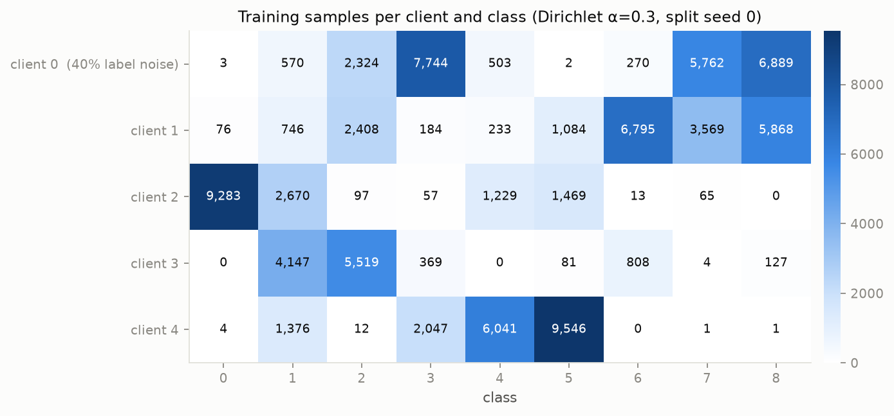

## Requirement → code map

| Assignment requirement | Where |
|---|---|
| FedAvg and FedProx on PFLlib | `system/flcore/servers/serveravg.py`, `serverprox.py` (unchanged algorithms; new round loop in `serverbase.py::run_rounds`) |
| PathMNIST via a `generate_MNIST.py`-style script | `dataset/generate_PathMNIST.py` |
| 5 clients, Dirichlet α = 0.3 | `generate_PathMNIST.py` → `separate_data(..., partition="dir", alpha=0.3)`; `dataset/PathMNIST/config.json` records the counts |
| 40 % label noise on one client | `system/flcore/clients/clientbase.py::_corrupt_labels`; flags `--noisy_client 0 --noise_rate 0.4` |
| Global and per-client accuracy, with plots | `serverbase.py::evaluate_metrics`; Fig. 1, 2, 6; Tables 1, 2 |
| W&B: global + per-client accuracy and loss every round | `serverbase.py::log_round` → `wandb.log` every round (`eval_gap = 1`) |
| W&B: update norms and cosine values | `serverbase.py::compute_update_stats` → `client_k_update_norm`, `client_k_cosine`, `client_k_cosine_loo`, `global_update_norm` |
| One public project, clear run names | project `fl-pathmnist-noisy`; names `fedavg_seed0`, `fedprox_mu0.01_seed0`, `fedprox_mu0.1_seed1`, `fedavg_seed0_clean`, … (`main.py::make_run_name`) |
| README listing all changes | this file, next section |

## Changes to PFLlib

Base: PFLlib commit `0169ba7e412c9856a08bb3faefab1e35f538a3c1`. `git diff --stat 0169ba7` on the modified files:

```
dataset/utils/dataset_utils.py      |   2 +-
system/flcore/clients/clientbase.py | 122 +++++++++++++++++-
system/flcore/servers/serveravg.py  |  44 +-------
system/flcore/servers/serverbase.py | 192 ++++++++++++++++++++++++-
system/flcore/servers/serverprox.py |  44 +-------
system/main.py                      | 107 ++++++++++++++-
.gitignore                          |  19 +++
```

### Modified files

| File | Change | Why |
|---|---|---|
| `dataset/utils/dataset_utils.py` | `separate_data(..., alpha=alpha)` gains an `alpha` argument (module default 0.1 unchanged, so other datasets are unaffected) | the task needs α = 0.3 |
| `system/main.py` | `wandb` is imported and `wandb.init` is called on every run (needs a W&B login, or `WANDB_MODE=offline`); removed the module-level `torch.manual_seed(0)`; added `set_seed(seed)` (seeds `random`, `numpy`, `torch`); new args `--seed`, `--noisy_client`, `--noise_rate`, `--diag_noise_rate` (default 0.4), `--wandb_project`, `--run_tag`; `mps` device option; `wandb.init` with the full config (incl. `pfllib_commit`, `split_seed`, `partition_alpha`, `normalization`, `noise_type`) before seeding; PathMNIST model branch `FedAvgCNN(in_features=3, dim=1024)`; per-run output folder `outputs/<run name>_<wandb id>/` with `config.json`, `metrics.csv`, `metrics.jsonl`, `noise_indices.npz`, `final_model.pt`, `best_val_model.pt` | seeds, noise, W&B, artefacts |
| `system/flcore/clients/clientbase.py` | removed the per-client `torch.manual_seed(0)`; training data is read once and cached (`get_train_data`); `_corrupt_labels` injects the noise on `noisy_client` with its own `np.random.default_rng(seed)` (for clean runs the same subset is drawn as *hypothetical* targets, `applied=False`, so the diagnostic below is comparable); `corrupted_subset_metrics` (predictions of the current model on the corrupted subset); `clean_test_metrics` / `train_loss_metrics` returning `(correct, n, loss_sum)`; evaluation `DataLoader`s get `generator=torch.Generator().manual_seed(0)` | label noise; evaluation must not touch the training RNG (a DataLoader iterator consumes the global torch RNG even with `shuffle=False`) |
| `system/flcore/servers/serverbase.py` | new round loop `run_rounds()` (select → send → train → receive → `compute_update_stats` → aggregate → send → `evaluate_metrics` → `_update_best_val` → `log_round`); `evaluate_metrics` (per-client clean test acc/loss, train loss, sample-weighted global metrics, val metrics, corrupted-subset metrics, RNG-fingerprint guard); `evaluate_val` (official val split); `compute_update_stats` (update norms, cosine to the weighted mean update, leave-one-out cosine); `log_round` (history + `metrics.jsonl` + `wandb.log`); `_update_best_val` (saves `best_val_model.pt`); server-owned `self.py_rng = random.Random(seed)` used for client sampling | all logging; determinism (wandb's retry thread calls the global `random`, which changed client order in early exploration runs) |
| `system/flcore/servers/serveravg.py`, `serverprox.py` | `train()` is now `run_rounds(); save_results(); save_global_model()`. **Removed** from the loop: `auto_break` early stopping, DLG evaluation (`dlg_eval`, `call_dlg`), the new-client fine-tuning block (`num_new_clients`), and the `Budget` timing print. The aggregation and the FedProx optimiser are untouched. | one shared loop that evaluates and logs every round |
| `.gitignore` | ignore `fl-env/`, raw and generated dataset files, `*.pt`, `wandb/` | keep the repo small; metrics and noise records are committed |

### Added files

| File | Purpose |
|---|---|
| `dataset/generate_PathMNIST.py` | downloads PathMNIST, partitions train (Dirichlet, α = 0.3, seed 0), allocates test per class, writes `dataset/PathMNIST/{train,test}/<k>.npz`, `partition_indices.npz`, `config.json`, and the heatmap |
| `system/run_main.sh` | experiment driver: `check`, phases `0` (lr sweep), `1`, `2` (μ sweep), `3` (remaining seeds + clean baselines) |
| `system/run_extension.sh` | post-selection extension: clean FedProx μ = 0.1, seeds 0–2 (PROTOCOL.md, Amendment 1) |
| `system/select_mu.py` | applies the frozen μ-selection rule (validation only) |
| `system/plot_results.py` | all figures (`plots/fig*.png`) and tables (`plots/results_tables.md`, `results_summary.json`) |
| `system/progress.py` | prints progress / time left for a phase |
| `system/check_noise.py`, `check_eval.py`, `check_update_stats.py`, `check_smoke.py`, `check_pairing.py` | one-off implementation checks (noise record, evaluation RNG isolation, cosine/norm sanity, 3-round smoke test, FedProx(μ=0) ≡ FedAvg and noisy/clean pairing) |
| `PROTOCOL.md` | dated, pre-registered decisions and amendments |
| `plots/`, `outputs/`, `logs/` | figures; per-run metrics, configs and noise records (checkpoints are git-ignored); stdout logs |
| `requirements.txt` | `pip freeze` of the environment used |

## Reproduce

Environment used: macOS (Apple M-series, arm64), Python 3.11.13, torch 2.15.0, torchvision 0.29.2, medmnist 3.0.2,
wandb 0.31.0, numpy 2.4.6, matplotlib 3.11.2, scikit-learn 1.9.1 (full list in `requirements.txt`; the torch pin is
for macOS arm64, so on other platforms install torch for your platform first).

**Total compute:** ≈ 31 h on one M-series CPU (22 runs × 200 rounds at ≈ 25 s/round, plus checks and the lr sweep).

```bash
python3.11 -m venv fl-env && source fl-env/bin/activate
pip install -r requirements.txt
wandb login                      # main.py always calls wandb.init; without an account use: export WANDB_MODE=offline

# 1. data (≈ 450 MB in dataset/PathMNIST/, partition is fixed by split_seed=0 inside the script)
cd dataset && python generate_PathMNIST.py && cd ..

# 2. implementation checks (3-round runs, ~5 min) and their verification
cd system
./run_main.sh check && python check_pairing.py

# 3. experiments, in the order they were run (≈ 25 s/round on an M-series CPU, 200 rounds per run)
./run_main.sh 1                  # seed 0: fedavg_seed0, fedprox_mu0.01_seed0      (budget rule → keep 200 rounds)
./run_main.sh 2                  # μ sweep on seed 0: μ ∈ {0.001, 0.1, 1.0}
python select_mu.py              # frozen rule → μ = 0.1
BEST_MU=0.1 ./run_main.sh 3      # seeds 1–2 for FedAvg / FedProx 0.01 / FedProx 0.1, clean baselines seeds 0–2
./run_extension.sh               # clean FedProx μ=0.1, seeds 0–2 (post-selection extension)

# 4. figures and tables
python plot_results.py           # → ../plots/
```

A single run, for reference (this is what `run_main.sh` executes):

```bash
python -u main.py -data PathMNIST -ncl 9 -m CNN -gr 200 -nc 5 -jr 1 -ls 1 -lr 0.01 -lbs 32 -dev cpu \
  --noisy_client 0 --noise_rate 0.4 --seed 0 -algo FedProx -mu 0.1          # → run name fedprox_mu0.1_seed0
python -u main.py ... --noise_rate 0 --run_tag clean --seed 0 -algo FedAvg   # → fedavg_seed0_clean
```

`--seed` seeds Python `random`, NumPy and torch before the model is built (`main.py::set_seed`), so it fixes the
initialisation, the training batch order and the noise subset. The partition does not depend on it. A clean run with
the same seed shares the noisy run's initialisation and batch order; the reproducibility checks
(`check_pairing.py`: identical RNG fingerprints every round, identical round-0 metrics, FedProx μ = 0 ≡ FedAvg with
zero parameter difference) are consistent with matched initialisation and batch ordering.

The lr sweep (exploration, FedAvg seed 0, 100 rounds) is `GR=100 ./run_main.sh 0`; its runs live in
`outputs/exploration/` and are tagged `_explore` in W&B.

## What is logged

Every round, to W&B (`step_metric = round`), `outputs/<run>/metrics.jsonl` and `metrics.csv`:

| Key | Meaning |
|---|---|
| `global_test_acc`, `global_test_loss` | global model on the union of the clients' test sets (sample-weighted mean of the per-client values); CE loss |
| `client_k_test_acc`, `client_k_test_loss` | global model on client *k*'s test examples (labels always clean) |
| `global_train_loss`, `client_k_train_loss` | plain CE of the global model on the training data **with the labels the client trains on** (corrupted for client 0), no prox term |
| `global_val_acc`, `global_val_loss` | global model on the official val split (selection only) |
| `client_k_update_norm` | ‖w_k − w_global‖₂ after local training |
| `client_k_cosine` | cosine between client *k*'s update and the sample-weighted mean update of all clients |
| `client_k_cosine_loo` | cosine between client *k*'s update and the weighted mean of the **other** clients' updates (used in the figures; `cosine` is inflated by the client's own share) |
| `global_update_norm` | norm of the aggregated update |
| `client_0_corrupted_pred_noisy / _original / _other` | fraction of client 0's 9,626 corrupted training samples on which the global model predicts the injected label / the original label / neither |
| `best_val_acc_so_far`, `best_val_round_so_far` | running best validation accuracy and its (earliest) round; `best_val_model.pt` is saved at that round |
| `rng_state_crc` | CRC of the torch + NumPy RNG state at the start of the round; equal across paired runs |
| `round_train_time_sec`, `round_total_time_sec` | timing |

Per run, `outputs/<run name>_<wandb id>/` also holds `config.json` (all arguments + dataset config + commit) and
`noise_indices.npz` (indices, original and injected labels, `applied` flag).

## Results

All numbers are **test** accuracy of the global model after 200 rounds unless stated otherwise; sd is the sample
standard deviation over seeds 0–2. Every decision (lr, μ, budget) was made on validation accuracy only, before the
corresponding test numbers were looked at (see Disclosures for one exception).

### Global accuracy

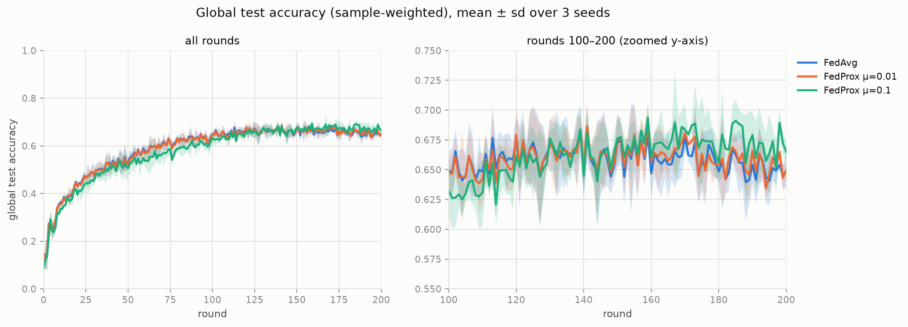

**Table 1. Global test accuracy (%), noisy setting, 200 rounds, 3 seeds**

| Method | seed 0 | seed 1 | seed 2 | final (r200) mean ± sd | last-10 mean ± sd | at best-val round, mean ± sd | Δ vs FedAvg per seed (final) | Δ mean ± sd |
|---|---|---|---|---|---|---|---|---|
| FedAvg | 64.2 | 63.8 | 66.7 | **64.9 ± 1.6** | 64.9 ± 1.0 | 68.0 ± 0.9 (r 170, 122, 131) | — | — |
| FedProx μ=0.01 | 64.1 | 65.2 | 65.6 | **64.9 ± 0.8** | 65.2 ± 0.2 | 67.4 ± 0.8 (r 170, 133, 161) | −0.2 / +1.4 / −1.1 | +0.0 ± 1.3 |
| FedProx μ=0.1 | 66.2 | 65.8 | 67.4 | **66.5 ± 0.8** | 66.8 ± 1.4 | 70.3 ± 0.7 (r 185, 189, 181) | +2.0 / +2.1 / +0.7 | +1.6 ± 0.8 |

Δ = paired per-seed difference (same seed → same initialisation, batch order and noise subset). Seed 0 is the
development seed (lr and μ were selected on its validation accuracy); on the two evaluation seeds alone (1–2) the
final accuracies are FedAvg 65.2, FedProx 0.01 65.4, FedProx 0.1 66.6.

- **FedAvg vs FedProx μ = 0.01:** no difference. The paired differences change sign across seeds and the two
  curves overlap throughout (Fig. 1), plausibly because the proximal term is small relative to the gradient at
  μ = 0.01.
- **FedProx μ = 0.1** (the validation-selected μ) is ahead of FedAvg on every seed, by 0.7–2.1 points, and on
  every secondary endpoint. This is a small advantage on a single fixed partition with three seeds; we report it
  as "small and consistent", not as a significant improvement. It learns more slowly at first; the curves cross
  over around r125–150 (Fig. 1, right).
- **Late-round behaviour.** Test accuracy at the best-validation round is 2.5–4 points above the final round for
  every method (Table 3). Part of that gap is selection: the best of 200 validation values also lands on a good test
  round, and the clean runs show gaps of 0.4–2 points with no decline. Comparing 20-round windows (r121–140 vs
  r181–200), FedAvg and FedProx 0.01 lose about 1 point (66.4 → 65.1 %, 66.3 → 65.5 %) while their test loss rises
  (0.96 → 1.11, 0.96 → 1.08); FedProx 0.1 does not decline (66.1 → 67.3 %) and its test loss is flat; the clean runs
  keep improving. The decline coincides with the growth of excess agreement (Fig. 8); we do not claim it is caused
  by it (clean FedAvg's test loss also rises, 0.83 → 0.92, while its accuracy rises, so a rising test loss is not by
  itself a noise signature). The final round stays the primary endpoint because it was declared in advance.
- **Validation vs test.** Validation accuracy is 8–9 points above test on final values (≈ 7–9 points at the
  best-validation round, Table 3). PathMNIST's test split comes from a different source centre than train/val, so
  part of this gap is plausibly a domain shift; we treat it as an empirical observation.

**Table 3. Validation vs test (noisy setting, mean over 3 seeds)**

| Method | best val acc (%) | best-val round (per seed) | test acc at best-val round (%) | final test acc (%) | final val acc (%) |
|---|---|---|---|---|---|
| FedAvg | 76.3 | 170, 122, 131 | 68.0 | 64.9 | 73.1 |
| FedProx μ=0.01 | 76.6 | 170, 133, 161 | 67.4 | 64.9 | 74.0 |
| FedProx μ=0.1 | 77.4 | 185, 189, 181 | 70.3 | 66.5 | 75.2 |

### Per-client accuracy

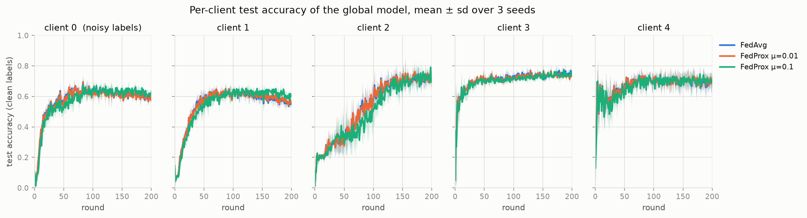
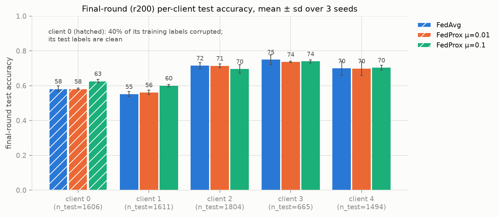

**Table 2. Final-round per-client test accuracy (%), mean ± sd over 3 seeds**

| Client | n_train | n_test | FedAvg | FedProx μ=0.01 | FedProx μ=0.1 |
|---|---|---|---|---|---|
| 0 (40 % label noise) | 24,067 | 1,606 | 58.3 ± 1.7 | 58.2 ± 0.3 | 62.6 ± 1.0 |
| 1 | 20,963 | 1,611 | 55.2 ± 1.5 | 56.2 ± 1.3 | 60.0 ± 0.6 |
| 2 | 14,883 | 1,804 | 71.6 ± 1.7 | 71.5 ± 1.1 | 69.6 ± 2.5 |
| 3 | 11,055 | 665 | 75.0 ± 2.8 | 73.7 ± 0.4 | 74.0 ± 0.9 |
| 4 | 19,028 | 1,494 | 69.9 ± 4.1 | 69.9 ± 3.9 | 70.4 ± 1.4 |

- The noisy client 0 and client 1 are the two worst clients (55–63 %), the other three are at 70–75 %.
  Client 1 is also the second-lowest client without noise (66.6 % for clean FedAvg, Table 2b), so part of its gap is
  class difficulty. Its drop under noise (−11.4 points for FedAvg) is second only to client 0's (−13.7) (Table 2b,
  Fig. 10), consistent with client 1's two large classes 7 and 8 (3,569 and 5,868 samples) being two of client 0's
  largest (5,762 and 6,889, Fig. 0). Class overlap does not explain the other clients' penalties (client 2 shares
  almost no classes with client 0 and still loses 8 points; client 4 shares class 3 and loses nothing), so this is
  one plausible factor, not a full account. We did not test per-class accuracy.
- Client 2 is a near single-class client (class 0, 62 % of its data, which almost no other client holds); its
  accuracy keeps rising until round 200 (Fig. 2) because that class is learnt late.
- FedProx μ = 0.1 gains most on exactly the two noise-exposed clients (+4.3 and +4.8 points) and loses a little on
  client 2.

**Table 2b. Per-client effect of the noise: final test accuracy (%), clean / noisy / Δ (noisy − clean), mean over 3 seeds**
(not pre-registered; added after the runs)

| Client | FedAvg clean / noisy / Δ | FedProx μ=0.01 clean / noisy / Δ | FedProx μ=0.1 clean / noisy / Δ |
|---|---|---|---|
| 0 (noisy) | 72.0 / 58.3 / **-13.7** | 71.9 / 58.2 / **-13.7** | 74.9 / 62.6 / **-12.3** |
| 1 | 66.6 / 55.2 / **-11.4** | 68.5 / 56.2 / **-12.4** | 70.2 / 60.0 / **-10.1** |
| 2 | 79.6 / 71.6 / **-8.0** | 80.6 / 71.5 / **-9.1** | 77.2 / 69.6 / **-7.6** |
| 3 | 80.1 / 75.0 / **-5.1** | 79.8 / 73.7 / **-6.2** | 81.9 / 74.0 / **-7.9** |
| 4 | 68.9 / 69.9 / **+1.1** | 68.4 / 69.9 / **+1.5** | 67.7 / 70.4 / **+2.7** |

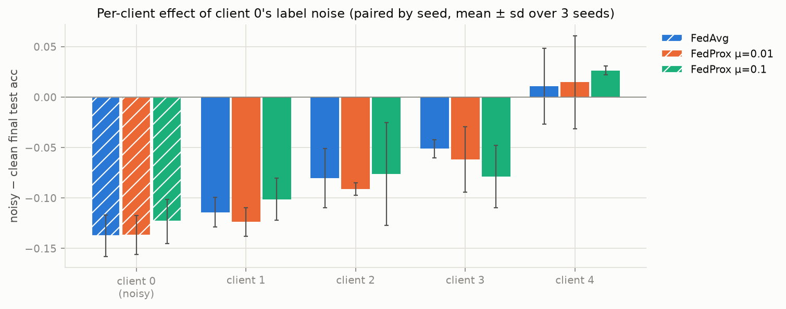

### Losses

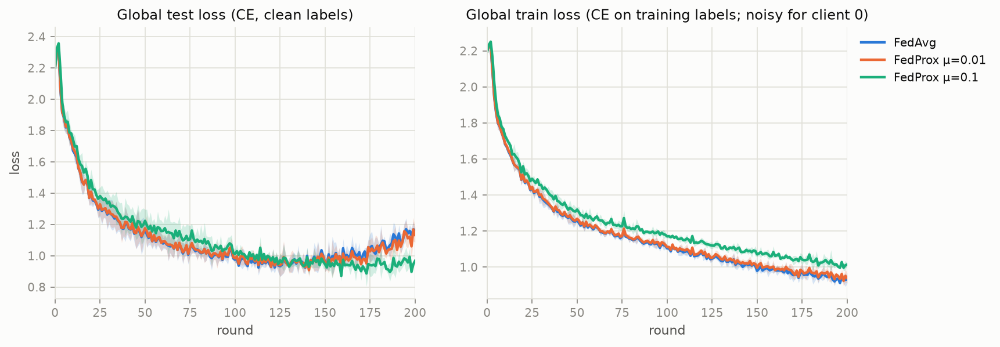
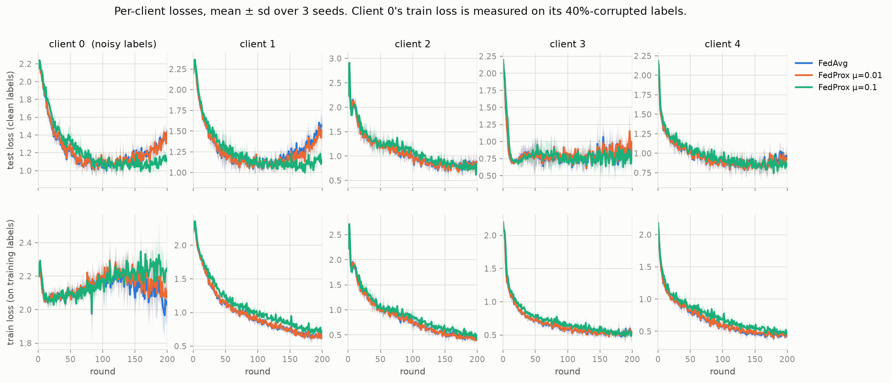

Train loss is measured on the labels each client trains on, so client 0's train loss is against its 40 %-corrupted
labels: it rises to ≈ 2.2 by r100 while every other client's train loss falls. For FedAvg it then falls back to
≈ 2.0 by r200 (FedProx 0.01: ≈ 2.1) as the model begins to fit the corrupted labels (Fig. 8), whereas for μ = 0.1 it
keeps rising to a peak of ≈ 2.35 around r160 and is still ≈ 2.2 at r200 (Fig. 4, bottom-left). Test loss turns upward after ~r150 for FedAvg and FedProx 0.01 but
stays flat for μ = 0.1.

### Update norms and cosine values

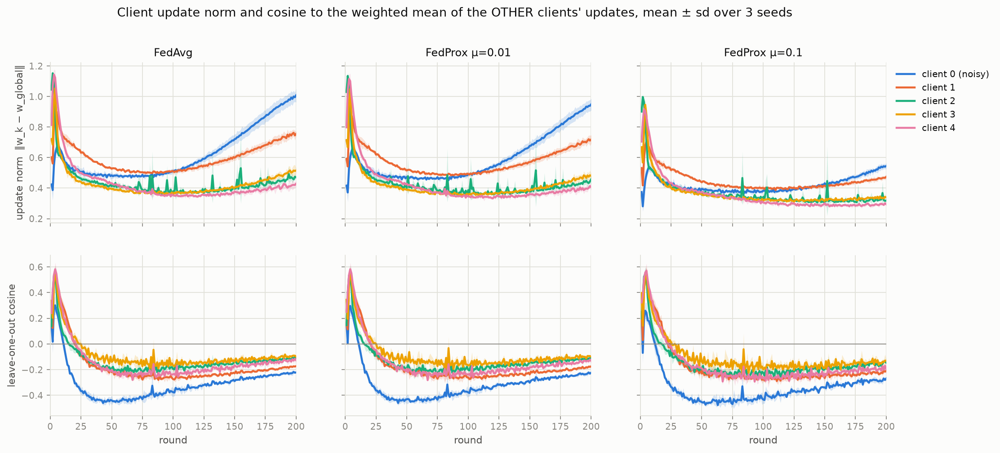

Clients take different numbers of local steps per round (one epoch at batch 32: ≈ 752 for client 0, ≈ 345 for
client 3), which is context for the norm values.

- **Update norms.** Up to ~r100 client 1 has the largest update norm. From ~r100 client 0's norm grows steadily
  (0.5 → 1.0 for FedAvg, 0.5 → 0.95 for FedProx 0.01) and becomes the largest; clients 2–4 stay at 0.35–0.55 and
  client 1 grows more weakly (0.5 → 0.76). In the paired clean runs client 0 stays at ≈ 0.46 throughout (Fig. 7);
  the paired runs differ only in the labels, so the growth is attributable to the label noise. With μ = 0.1 the
  growth is much smaller (0.38 → 0.54, against 0.42 in its clean twin).
- **Cosine.** The leave-one-out cosine (client update vs the weighted mean of the other clients' updates) is
  positive only in the first ~10–25 rounds; from ~r25 it is negative for every client (−0.1 to −0.25), the usual
  signature of non-IID local objectives. Client 0 is the most misaligned client between ~r25 and ~r150 (−0.45 at
  r50 versus −0.1 to −0.25 for the others, and −0.09 for its clean twin, Fig. 7). By r200 the noisy and clean
  client-0 curves have converged (≈ −0.23). The cosine therefore separates the noisy client only in mid-training
  and only in contrast to the others, not by sign; the update norm separates it increasingly late in training.

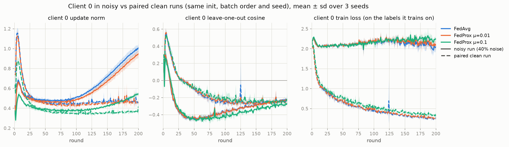

### Does the global model learn the wrong labels?

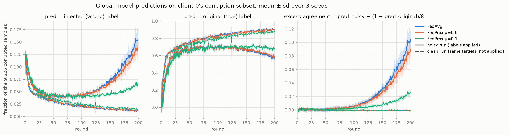

On client 0's 9,626 corrupted training samples we track how often the global model predicts the *injected* label.
Because the injected label is always different from the true one, a model that is simply wrong by chance would hit
it with probability (1 − pred_original)/8; we call the difference "excess agreement".

**Table 5. Final global model on the corruption subset (r200, mean ± sd over 3 seeds)**

| Method | run | pred = injected label | pred = original label | excess agreement |
|---|---|---|---|---|
| FedAvg | noisy | 0.158 ± 0.019 | 0.572 ± 0.030 | +0.104 ± 0.015 |
| FedAvg | clean (targets drawn, not applied) | 0.011 ± 0.001 | 0.906 ± 0.007 | −0.000 ± 0.000 |
| FedProx μ=0.01 | noisy | 0.142 ± 0.011 | 0.584 ± 0.018 | +0.090 ± 0.009 |
| FedProx μ=0.01 | clean | 0.012 ± 0.003 | 0.902 ± 0.017 | −0.000 ± 0.001 |
| FedProx μ=0.1 | noisy | 0.066 ± 0.004 | 0.682 ± 0.014 | +0.026 ± 0.003 |
| FedProx μ=0.1 | clean | 0.014 ± 0.002 | 0.882 ± 0.014 | −0.001 ± 0.001 |

The clean runs, which never saw the injected labels, sit at zero excess within ±0.001, which validates the baseline. In the
noisy runs excess agreement is ~0 until round ~100 and then grows; by round 200 FedAvg predicts the injected label
on 16 % of the corrupted samples (10 points above chance). With μ = 0.1 the growth is four times smaller and the
original-label accuracy on those samples stays 10 points higher. This is consistent with the proximal term slowing
the fitting of the wrong labels; it does not show that FedProx detects noise, and μ = 1.0, which removes the excess
entirely, also removes 15 points of validation accuracy (Table 6).

### Selection sweeps (validation only)

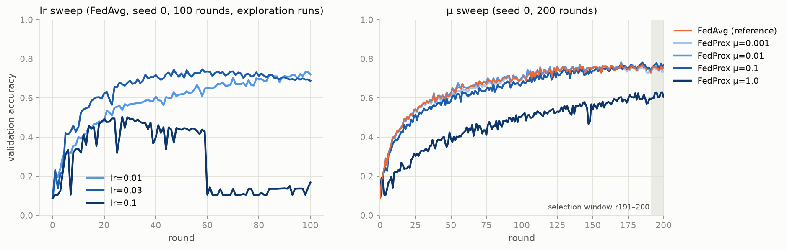

**Table 6. Seed 0, validation accuracy**

| Run | mean val acc r191–200 (%) | best val acc (%) @ round |
|---|---|---|
| FedAvg | 75.07 | 77.45 @ r170 |
| FedProx μ=0.001 | 74.35 | 76.73 @ r170 |
| FedProx μ=0.01 | 75.38 | 78.17 @ r170 |
| FedProx μ=0.1 | **76.21** | 78.09 @ r185 |
| FedProx μ=1.0 | 61.16 | 62.94 @ r199 |

lr = 0.01 was chosen from a short lr sweep (left panel; details in PROTOCOL.md). μ was selected by the
highest mean validation accuracy over rounds 191–200 (ties → smaller μ): μ = 0.1. The μ = 0.01 runs are reported
because the assignment names that value; μ = 0.1 is labelled "validation-selected" everywhere.

## Extension: noise penalty with paired clean baselines

The clean baselines for FedAvg and FedProx 0.01 were part of the frozen protocol; the clean FedProx 0.1 runs were
added after the μ sweep (PROTOCOL.md, Amendment 1) to separate "μ = 0.1 fits the noise less" from "μ = 0.1 fits
everything less". The added runs did not change μ, the budget or the primary endpoint. Each noisy run has a clean
twin (`--noise_rate 0`, same seed → same initialisation and batch order), and we compare the noise penalty
D = clean − noisy final test accuracy.

**Table 4. Noise penalty, percentage points, paired by seed**

| Method | clean seed 0/1/2 | noisy seed 0/1/2 | D seed 0/1/2 | D mean ± sd | clean mean ± sd |
|---|---|---|---|---|---|
| FedAvg | 72.8/72.4/73.2 | 64.2/63.8/66.7 | +8.6/+8.7/+6.5 | +7.9 ± 1.2 | 72.8 ± 0.4 |
| FedProx μ=0.01 | 73.8/73.1/73.1 | 64.1/65.2/65.6 | +9.7/+7.9/+7.6 | +8.4 ± 1.2 | 73.3 ± 0.4 |
| FedProx μ=0.1 | 75.6/72.4/72.7 | 66.2/65.8/67.4 | +9.4/+6.6/+5.3 | +7.1 ± 2.1 | 73.6 ± 1.8 |

Without noise the three methods are equivalent (72.8–73.6 %), so μ = 0.1's advantage in the noisy setting is not
bought with lower clean accuracy. Corrupting 40 % of one client's labels costs every method 7–8 points of global
test accuracy. μ = 0.1 has the smallest mean penalty, but the seed-to-seed spread (sd 2.1) is as large as the
differences between methods, so we do not claim that FedProx reduces the noise penalty.

## Disclosures and limitations

- **Seed 0 is the development seed.** lr, the round budget and μ were chosen on its validation accuracy, and it is
  one of the three seeds in every mean. Seeds 1–2 are reported separately above.
- **Fixed partition.** All seeds share one Dirichlet draw (`split_seed = 0`), so the sd over seeds covers
  initialisation, batch order and the noise subset but not partition variability.
- **Validation / test domain shift.** The official PathMNIST test set comes from a different source centre than
  train and val, so test accuracy is 8–9 points below validation on final values for every method.
- **μ = 0.1 was selected on data that is also reported.** Its comparison against FedAvg is development-tuned;
  the μ = 0.01 comparison is the pre-specified one.
- **Incidental test viewing.** While investigating a continuity question between the exploration runs and Phase 1
  (see next point), a few test accuracies (Phase 1 FedAvg at rounds 50/100, the exploration runs, and one clean
  run's PFLlib summary line) were printed and seen before Phase 3 was launched. No decision used them; all
  selection rules are stated in PROTOCOL.md and were applied to validation accuracy only.
- **Exploration runs were not fully deterministic.** In the lr-sweep and first 50-round runs (W&B `*_explore`),
  evaluation DataLoaders consumed the training RNG and wandb's retry thread advanced Python's global `random`,
  which changed the client order. Both were fixed before the reported runs (`check_pairing.py` passes); the
  exploration runs are kept for transparency only. Their validation curve at lr 0.01 differs from the reported
  `fedavg_seed0` after round 0 for this reason.
- **Interrupted run.** `fedprox_mu0.01_seed2_clean` was interrupted at round 122 when the terminal was closed; it
  was rerun from scratch. The partial run is in `outputs/incomplete/` (git-ignored) and shows as crashed in W&B
  (`fedprox_mu0.01_seed2_clean_crashed`).
- **Planned diagnostics not run.** Amendment 1 listed per-class and confusion-matrix diagnostics that were not
  carried out (PROTOCOL.md, Deviation note). Table 2b and Fig. 10 were added after the runs and were not
  pre-registered.
- **Server-held validation set.** Selection uses a clean validation set held by the server. This is a
  simplification; real FL servers usually have no such data.
- **Choice of noisy client.** Client 0 was chosen by index; it happens to be the largest client.
- **Clean-vs-noisy claims** are limited to FedAvg, FedProx 0.01 and FedProx 0.1, the only configurations with
  clean baselines; the μ = 0.1 clean runs were added post hoc.
- **What this does not show.** Three seeds on one partition with a small CNN: the FedProx 0.1 advantage
  (+1.6 ± 0.8) and the smaller noise penalty are consistent across seeds but not statistically established, and the
  corrupted-subset diagnostic shows *that* the wrong labels are being fitted, not a mechanism.

## Repository layout

```
PROTOCOL.md                      pre-registered protocol, outcomes, amendment
README.md / README_PFLlib.md     this file / the original PFLlib README
requirements.txt
dataset/generate_PathMNIST.py    data download + partition
dataset/PathMNIST/config.json    partition and allocation record (counts per client and class)
dataset/PathMNIST/partition_indices.npz
system/main.py                   entry point (args, W&B, run folder)
system/run_main.sh, run_extension.sh, select_mu.py, progress.py, plot_results.py, check_*.py
system/flcore/{clients/clientbase.py, servers/serverbase.py, serveravg.py, serverprox.py}
outputs/<run>_<wandb id>/        config.json, metrics.jsonl, metrics.csv, noise_indices.npz  (+ *.pt, git-ignored)
outputs/exploration/             lr sweep and first 50-round runs
logs/<run>.log                   stdout of every run
plots/fig0..fig10*.png, results_tables.md, results_summary.json
```
